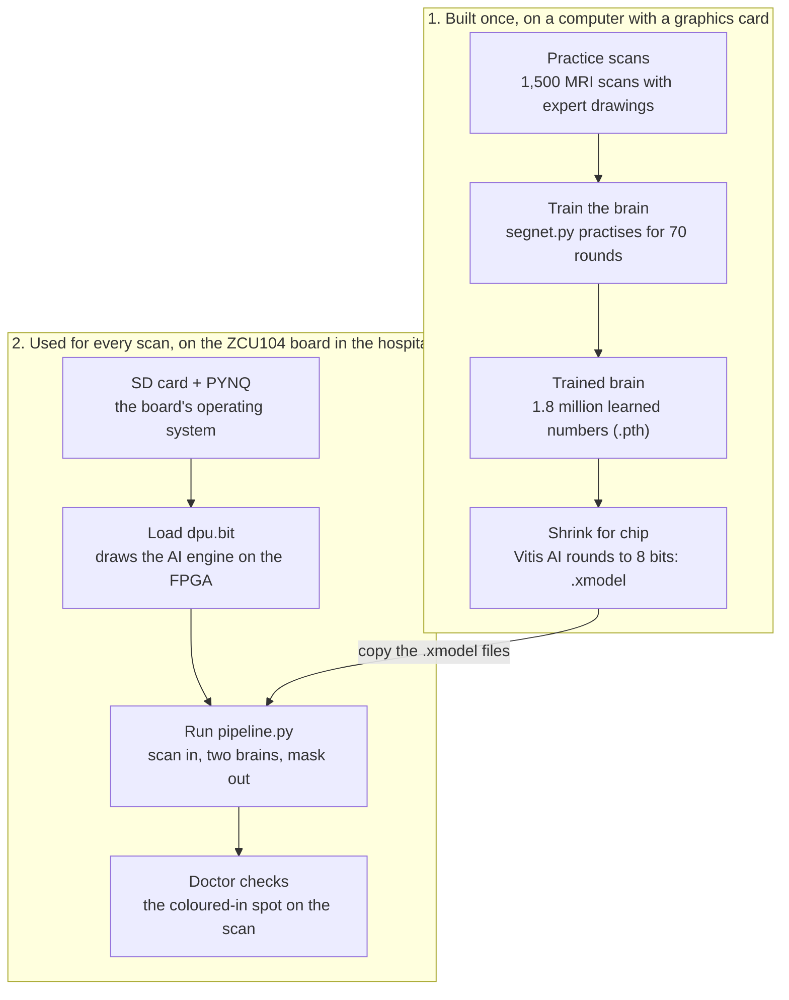
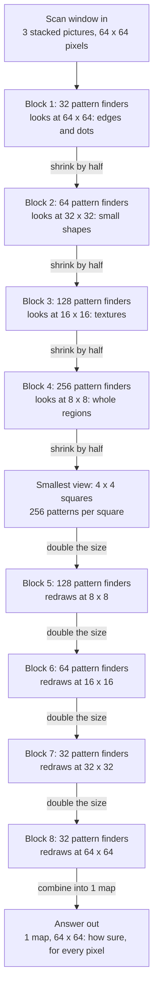

# How SegNet-Lite Works: The Complete Beginner's Guide

Everything about this project, explained for someone with no AI or electronics background: what it does, every part, how the brain inside works, how it was trained, how it was shrunk for the chip, and how to set up and run the board yourself. For a shorter overview, see [EXPLAINED.md](EXPLAINED.md). For the technical summary, see the [README](README.md).

## The story in one minute

SegNet-Lite is a small computer brain on a chip board that looks at prostate MRI scans and colours in the spots that might be cancer. A doctor then checks those spots.

Imagine a doctor has a huge pile of photos of the inside of people's bodies. Somewhere in a few of them is a tiny shadow that could be cancer. Looking through every photo takes a long time, and a tired eye can miss a small shadow.

So three engineering students built a helper. First they showed a computer thousands of these photos where experts had already circled the bad spots. The computer practised over and over until it could circle them itself. Then they squeezed that computer brain onto a small board, about the size of a school notebook, that can sit in the hospital. A photo goes in, and a fiftieth of a second later the board shows the photo with the worrying spot coloured in.

## The parts list

**Things you can hold**

| Part | What it is | Its job in this project |
| --- | --- | --- |
| Xilinx ZCU104 board | A green circuit board about the size of a notebook, built around a Zynq UltraScale+ FPGA chip | Runs the finished brain inside the hospital |
| microSD card (8 GB or more) | The same kind of memory card a phone or camera uses | Holds the board's operating system, like a hard drive |
| 12 V power adapter | A plug-in power brick | Powers the board |
| Ethernet cable | A network cable | Lets your laptop talk to the board |
| Micro-USB cable (optional) | A phone-charger-style cable | Lets you see the board's text messages while it starts up |
| A laptop or PC | Any normal computer with a web browser | You control the board from its browser |
| A computer with a graphics card | A gaming-style PC or a cloud machine | Used once, to train the brain. Training on a normal laptop would be very slow |

**Programs**

| Program | What it is | Its job |
| --- | --- | --- |
| Python | A programming language | Both project scripts are written in it |
| PyTorch | A toolkit for building and training AI brains | Used in `segnet.py` to build and train the model |
| OpenCV, NumPy, Matplotlib | Toolkits for pictures, numbers and charts | Load the scans, do the maths, draw the results |
| Vitis AI | AMD/Xilinx's tool for preparing AI models for their chips | Shrinks the trained brain and translates it for the chip |
| PYNQ | A ready-made Linux system for Xilinx boards, with Jupyter built in | The board's operating system, put on the SD card |
| DPU-PYNQ (`pynq-dpu`) | An add-on for PYNQ | Loads the AI engine onto the chip and runs the brain on it |
| Jupyter | A web page where you type and run Python | How you use the board from your laptop |

**Files that carry the brain**

| File | Made by | What it holds |
| --- | --- | --- |
| `segnet.py` | The team | The brain's design and the training steps |
| `segnet_lite_lesion.pth` | Training on the graphics-card computer | The trained brain: 1,773,312 learned numbers |
| `segnet_lite.xmodel`, `segnet_lite_lesion.xmodel` | Vitis AI | The two brains, shrunk and translated for the chip |
| `dpu.bit` | Comes with DPU-PYNQ | The wiring plan that turns part of the FPGA into an AI engine |
| `pipeline.py` | The team | The program that runs on the board: loads a scan, runs both brains, shows the result |
| Scan pictures (PNG) | Prepared from the PI-CAI MRI dataset | The input: three pictures per patient, plus expert outlines |

## The big picture

The project happens in two places. The brain is made once, on a powerful computer. Then it is copied to the board, which uses it again and again.



The top row is like a student studying for months. The bottom row is like that student sitting in the clinic, answering in a fraction of a second.

## How a computer sees a picture

A computer cannot see. To a computer, every picture is a grid of numbers, one number for each tiny square called a pixel.

In a black-and-white picture, 0 means black, 255 means white, and everything in between is a shade of grey. A tiny corner of an MRI picture might look like this to the computer:

```
 12   15   80  120
 14   90  200  210
 70  190  230  205
 60  110  140  130
```

The bright numbers in the middle are a lighter patch of tissue. That is all the brain ever gets: grids of numbers.

**Three pictures of the same spot.** An MRI machine can take several kinds of picture of the same slice of the body. SegNet-Lite uses three:

| Picture | What it shows | Why it helps |
| --- | --- | --- |
| T2W | The shape of the organs, like a normal photo | Shows where the prostate is |
| ADC | How freely water can move in each spot | Cancer cells are packed tightly, so water moves less there |
| HBV | The same water movement, measured a stronger way | Makes those packed spots stand out more |

The three pictures are stacked on top of each other like three sheets of tracing paper, so each pixel has three numbers instead of one. A colour photo works the same way, with red, green and blue layers.

**Getting the pictures ready.** Before the brain sees them, `segnet.py` does three things to every picture:

1. **Resize** it to 192 × 192 pixels, so every scan is the same size.
2. **Even out the brightness**, so a dark scan and a bright scan look alike. It subtracts the picture's average brightness and divides by how much the brightness varies (z-score normalisation).
3. **Cut a 64 × 64 window** around the area of interest, so the brain looks closely at a small square instead of the whole body.

**The answer is a picture too.** The brain gives back a grid the same size as the window. Each square holds a number for how sure it is that this pixel is cancer. Any square above 0.5 (more than half sure) is coloured in. That coloured grid is called a mask.

## Inside the brain

The brain is a stack of eight blocks shaped like a U. The first half squeezes the picture smaller and smaller to work out what is in it. The second half grows it back to full size to draw the answer.



**What a pattern finder is.** Each pattern finder is a tiny 3 × 3 stencil that slides across the picture, one square at a time. Where the picture matches the stencil, it lights up. This sliding is called a convolution. Early blocks find simple things like edges and bright dots. Later blocks combine those into bigger shapes, the way letters make words and words make sentences.

**Why squeeze?** Each squeeze step keeps the strongest value in every 2 × 2 square, which halves the picture's width and height (max pooling). A smaller picture forces the brain to keep only what matters, the way a short summary keeps only the main points.

**Why expand again?** A summary cannot be coloured in pixel by pixel. So the second half copies each square into a 2 × 2 patch, step by step, until the map is 64 × 64 again. At the very end, one last 1 × 1 stencil mixes the 32 patterns into a single map.

**The two helper steps in every block.** Each block makes two stencil passes. After each pass, batch normalisation keeps the numbers at a steady size, and ReLU turns every negative number into 0. Both keep training stable. In all, the brain has 1,773,312 learned numbers.

**One brain design, two jobs.** The repo defines this design for the lesion brain. The prostate brain is probably the same design trained on whole 192 × 192 pictures, but its training code is not in the repo.

## How it learned

The brain was not programmed with rules like "cancer is dark". It started out knowing nothing, with 1,773,312 random numbers inside, and learned by practising on examples, the way you learn to catch a ball by missing it many times.

**The practice material.** The team used the public PI-CAI collection: 1,500 MRI scans from 1,476 patients. 425 of them have serious cancer, and 220 come with an expert's drawing of exactly where the cancer is. The scans were turned into flat PNG pictures and sorted into the folders `segnet.py` expects:

```
prostate_cancer/
  images/
    cancer/<patient>/<patient>_t2w.png, _hbv.png, _adc.png
    non_cancer/<patient>/...
  masks/
    cancer/<patient>.png        (the expert's drawing)
    non_cancer/<patient>.png
```

**Healthy examples too.** For every two cancer patients, the code adds one healthy patient. If the brain only ever saw cancer, it would learn to colour in something on every scan.

**One round of practice**, as `segnet.py` runs it:

1. **Pick a handful.** Take 8 practice windows at random. This handful is called a batch.
2. **Guess.** The brain looks at each window and colours in where it thinks the cancer is.
3. **Score the guess.** Compare the guess with the expert's drawing and work out one number for how wrong it was. This number is the loss: lower is better.
4. **Find who to blame.** The computer works backwards through the brain and finds how much each of the 1.8 million numbers pushed the answer the wrong way (backpropagation).
5. **Nudge.** Change every number a tiny bit in the direction that makes the score better. The Adam optimiser decides how big each nudge is. The starting step size is 0.0001.
6. **Repeat** until every window has been used once. That is one epoch.

The code runs 70 epochs. Every 3 epochs it pauses and shows a picture: the scan, the expert's drawing in red, the brain's guess in blue, and both on top of each other. You can watch the blue patch slowly move onto the red one.

**How the score is worked out.** Cancer covers only a few pixels. A lazy brain could say "no cancer anywhere" and be right about 99% of the pixels. So the score adds two measures together:

- **Dice** checks how much the brain's patch overlaps the expert's patch. No overlap means a bad score, however many healthy pixels were right.
- **Focal loss** gives more weight to the pixels the brain finds hard and less to the easy background.

**The training settings, all from `segnet.py`:**

| Setting | Value | In plain words |
| --- | --- | --- |
| Batch size | 8 | Windows looked at before each nudge |
| Epochs | 70 | Times the whole practice set is gone through |
| Optimiser | Adam | The rule for how big each nudge is |
| Learning rate | 0.0001 | How big a nudge is to start with |
| Window size | 64 × 64 pixels | The square the brain looks at |
| Healthy to cancer ratio | 1 to 2 | Healthy examples mixed in |
| Focal loss settings | alpha 0.75, gamma 2 | How much extra weight hard pixels get |

When training ends, all the learned numbers are saved to one file, `segnet_lite_lesion.pth`. That file is the trained brain.

## Shrinking it for the chip

The trained brain cannot be copied onto the board as it is. It has to be shrunk and translated into the chip's own language first, using AMD/Xilinx's Vitis AI tools on a normal computer.

> **Note:** this repo does not include the script used for this step. The steps below are the standard Vitis AI route for a PyTorch model, which is what the repo's files point to (a `.pth` going in, `.xmodel` files coming out).

**Why shrink it?** After training, each of the 1,773,312 numbers is a long decimal like 0.0381927 stored in 32 bits. The chip's AI engine works with small whole numbers of 8 bits, from −128 to 127. Turning the long decimals into small whole numbers is called quantisation.

Think of a shop that rounds every price to the nearest rupee. The price list gets much shorter to write, adding up a bill gets faster, and the total hardly changes. For this brain the file goes from about 7.1 MB to about 1.8 MB, a 75% saving.

**Keeping track of the decimal point.** A whole number has no decimal point, so the chip remembers where it should be. Each layer gets a fix point value that says "move the point this many places". You will see `fix_point` in `pipeline.py`: the program uses it to turn the scan into small whole numbers on the way in, and the answer back into decimals on the way out.

**Why the brain is called Lite.** The chip's AI engine only knows a short list of building blocks. The team built the brain from those blocks only, and the code comments call it "DPU safe":

- Convolutions, batch normalisation and ReLU, which the chip runs.
- Max pooling and simple nearest-neighbour enlarging, which the chip runs.
- No final squashing step (sigmoid) inside the brain. The board's normal processor does that one small step afterwards.

**The build steps on a computer:**

1. **Set up Vitis AI.** Install Docker, then download the Vitis AI PyTorch container. Its version must match the AI engine on the board: the current DPU-PYNQ release is built for Vitis AI 2.5 ([DPU-PYNQ](https://github.com/Xilinx/DPU-PYNQ)).
2. **Calibrate.** Load the brain from `segnet_lite_lesion.pth` and run about a hundred practice windows through Vitis AI's quantiser in `calib` mode. It watches how big the numbers get in each layer and picks where each decimal point should go.
3. **Test and export.** Run the quantiser again in `test` mode, check the results still look right, and export a quantised `.xmodel` file ([Vitis AI user guide, PyTorch steps](https://docs.amd.com/r/1.4.1-English/ug1414-vitis-ai/Adding-vai_q_pytorch-APIs-to-Float-Scripts)).
4. **Compile.** Run the compiler, `vai_c_xir`, with an `arch.json` file that describes the exact AI engine on the board. It turns the brain into a list of instructions for that engine ([Vitis AI user guide, PyTorch workflow](https://docs.amd.com/r/1.4.1-English/ug1414-vitis-ai/PyTorch-Workflow)).
5. **Repeat for the prostate brain**, which gives the second file, `segnet_lite.xmodel`.

What steps 2 to 4 look like, as a sketch:

```python
from pytorch_nndct.apis import torch_quantizer

model = SegNetLiteNew()
model.load_state_dict(torch.load("segnet_lite_lesion.pth"))
sample = torch.randn(1, 3, 64, 64)            # the shape of one window

# Step 2: learn where the decimal points go
q = torch_quantizer("calib", model, (sample,))
for window, _ in calibration_windows:          # ~100 practice windows
    q.quant_model(window)
q.export_quant_config()

# Step 3: check and export
q = torch_quantizer("test", model, (sample,))
q.quant_model(sample)
q.export_xmodel()                               # quantised .xmodel
```

```bash
# Step 4: translate for the ZCU104's AI engine
vai_c_xir -x quantize_result/SegNetLiteNew_int.xmodel \
          -a arch.json -o compiled -n segnet_lite_lesion
```

## Setting up the board and "flashing" it

On this board, nothing is burned in for good. You copy an operating system onto the SD card once, and the AI engine is loaded into the chip fresh every time the program runs.

An FPGA forgets its wiring when the power goes off, like a whiteboard wiped clean. Each time `pipeline.py` starts, it loads the file `dpu.bit` into the chip, which draws the AI engine onto the whiteboard again. That takes about a second.

**Part 1: prepare the SD card (on your laptop, once)**

1. Download the PYNQ image for the ZCU104 from pynq.io. It is one big file.
2. Put a microSD card of at least 8 GB into your laptop ([PYNQ ZCU104 setup guide](https://pynq.readthedocs.io/en/v3.1/getting_started/zcu104_setup.html)).
3. Write the image to the card with a free SD-card writer such as balenaEtcher. This wipes the card and puts the whole PYNQ system on it ([how to write a PYNQ SD card](https://pynq.readthedocs.io/en/v3.1/pynq_sd_card.html)).

**Part 2: switch on the board**

1. **Tell it to start from the SD card.** Find the small block of four switches labelled SW6. Set switch 1 to ON and switches 2, 3 and 4 to OFF.
2. **Plug in power.** Connect the 12 V power cable. The plug only fits one way.
3. **Insert the SD card** into the slot underneath the board.
4. **Connect the network cable** from the board to your laptop, or to your home router.
5. **Optional:** connect the micro-USB cable to the port marked USB JTAG UART, to watch the start-up messages.
6. **Slide the power switch to ON.** A red light and some yellow lights come on. After a few seconds the red light turns yellow: the system is starting.

**Part 3: open the board from your laptop**

1. **Find the board.** Connected straight to your laptop, the board is at 192.168.2.99. Your laptop's network settings need a fixed address in the same range, such as 192.168.2.1. On a home router, the board gets an address automatically and its name is `pynq`.
2. **Open Jupyter.** Type the board's address into your browser. If the page does not open, add `:9090` to the end, which some PYNQ versions use.
3. **Log in.** The username and password are both `xilinx`.
4. **Open a terminal.** In Jupyter, choose New, then Terminal. This gives you a command line on the board itself.

**Part 4: install the AI engine add-on (once)**

The board needs internet for this step, so connect it through your router. In the Jupyter terminal, run ([DPU-PYNQ](https://github.com/Xilinx/DPU-PYNQ)):

```bash
pip3 install pynq-dpu --no-build-isolation
cd $PYNQ_JUPYTER_NOTEBOOKS
pynq get-notebooks pynq-dpu -p .
```

The first line installs the add-on that knows how to load the AI engine and run `.xmodel` brains. The last two copy its example notebooks, which are a good check that everything works before you try SegNet-Lite.

**Part 5: copy the project onto the board**

In Jupyter, use the Upload button to copy these files into a folder called `MRI` inside `jupyter_notebooks`. This is the layout `pipeline.py` expects:

```
/home/xilinx/jupyter_notebooks/MRI/
  pipeline.py
  dpu.bit                      (comes with pynq-dpu)
  segnet_lite.xmodel           (the prostate brain)
  segnet_lite_lesion.xmodel    (the lesion brain)
  10019.png                    (expert's lesion drawing for this patient)
  dataset/
    images/10019/10019_t2w.png, 10019_adc.png, 10019_hbv.png
    mask/10019.png             (expert's prostate drawing)
```

**Part 6: run it**

In the Jupyter terminal:

```bash
cd /home/xilinx/jupyter_notebooks/MRI
python3 pipeline.py
```

Or paste the contents of `pipeline.py` into a new notebook and press Run, which also shows the result pictures on screen. To try another patient, change `CASE_ID = "10019"` at the top of the file.

## What happens when you press Run

This is `pipeline.py` from top to bottom, in plain words. It handles one patient.

1. **Read the settings.** The top of the file names the patient (`10019`), the folders, the three brain files and the 0.5 cut-off for "coloured in".
2. **Start the stopwatch** for the whole run.
3. **Load the pictures.** Read the patient's T2W, ADC and HBV pictures, plus the expert's prostate drawing and lesion drawing, so the result can be marked afterwards.
4. **Stage 1, prepare.** Stack the three pictures in the order ADC, HBV, T2W, and scale every pixel from 0–255 down to 0–1.
5. **Stage 1, load.** Load `dpu.bit` into the chip, which draws the AI engine, then load the prostate brain, `segnet_lite.xmodel`, into that engine.
6. **Stage 1, convert.** Turn the picture's decimals into small whole numbers using the engine's `fix_point` setting.
7. **Stage 1, run.** Hand the numbers to the engine and wait for the answer. The stopwatch times only this part.
8. **Stage 1, read the answer.** Turn the answer back into decimals, squash each one into a 0–1 "how sure" value, and colour in every pixel above 0.5. That gives the prostate outline.
9. **Stage 1, mark it.** Compare the outline with the expert's drawing and print five scores: Dice, IoU, precision, recall and accuracy.
10. **Stage 2, prepare.** Resize the three pictures to 192 × 192 and even out their brightness, this time in the order T2W, HBV, ADC. The order and the brightness method match what each brain was trained on, like following each recipe exactly.
11. **Stage 2, zoom.** Cut a 64 × 64 window centred on the lesion.
12. **Stage 2, load, convert and run.** Load the lesion brain, `segnet_lite_lesion.xmodel`, and repeat steps 6 to 8 on the window. That gives the lesion patch.
13. **Stage 2, mark it.** Print the same five scores for the lesion.
14. **Draw the results.** A grid of 18 pictures: the three scans, the expert's prostate outline in red, the brain's outline in blue, then the same for the zoomed-in lesion.
15. **Print the timing.** Time for each stage on the chip, total chip time, total time including loading and drawing, and how many scans per second that adds up to.
16. **Try other cut-offs.** Recolour the lesion at cut-offs from 0.1 to 0.7 and print the scores for each, to see which works best.

**Two different speeds.** "Under 20 ms" is the chip time from step 15. The total time is longer, because it includes reading files, loading the engine and drawing 18 pictures. A hospital tool would load the engine once and keep it ready.

**Step 11 has a catch.** The window is centred using the expert's lesion drawing. A new patient has no expert drawing yet, so a finished tool would have to place the window using stage 1's prostate outline instead.

## Could you build it yourself?

Yes, with the right board and some patience, but not from this repo alone. The repo holds the recipe for the lesion brain and the program that runs on the board. Some ingredients are not in it.

| Missing piece | Where it comes from |
| --- | --- |
| The scans | Download PI-CAI, then turn each 3D scan into flat PNG slices with matching expert drawings, sorted into the folders shown in "How it learned" |
| The prostate brain's training script | Not in the repo. It is probably the same design as the lesion brain, trained on whole 192 × 192 pictures with prostate drawings |
| The trained files (`.pth`, `.xmodel`) | Listed in the README but not uploaded. You would train and convert them yourself |
| The conversion script | Not in the repo. "Shrinking it for the chip" shows the standard route |
| A ZCU104 board | Bought from AMD or a distributor. Other boards need a different AI engine and a recompile |

**Rough order of work:** prepare the scans → train both brains on a graphics-card computer → shrink and compile them with Vitis AI → set up the board → copy the files → run `pipeline.py`.

**Honest limits of the project as it stands.** It is a working student prototype, not a tested medical tool.

- **Graded on its own practice questions.** `segnet.py` measures its final scores on the same scans it trained on, like setting an exam from the practice paper. A fair score needs scans it has never seen.
- **The two stages are not yet joined.** Stage 2's window is placed using the expert's drawing, not stage 1's answer.
- **One patient per run.** `pipeline.py` checks a single patient, so the timing and scores describe that one case.
- **Most scores are not published.** The code prints Dice, IoU, recall and timing, but only the precision figure (about 93–95%) is written in the README.
- **No clinical testing.** Checking by radiologists and approval for hospital use are listed as future work.

None of this takes away from what was built: a custom brain, trained on a hard medical problem, shrunk to 8-bit numbers and running on an FPGA in a fiftieth of a second.

## Word list

| Word | Plain meaning |
| --- | --- |
| Adam | The rule that decides how big each nudge is during training |
| ADC, HBV, T2W | Three kinds of MRI picture of the same slice of the body |
| Backpropagation | Working backwards through the brain to find which numbers caused a mistake |
| Batch | The handful of examples looked at before each nudge (8 here) |
| Batch normalisation | A step that keeps the numbers inside the brain at a steady size |
| Bitstream (`dpu.bit`) | The wiring plan loaded into the FPGA |
| Convolution | A small window that slides over a picture looking for one pattern |
| Dice | An overlap score between the brain's patch and the expert's; 1 is perfect |
| DPU | The AI engine drawn onto the FPGA, built only to run AI brains |
| Epoch | One full pass through all the practice examples |
| Fix point | The note that says where the decimal point goes in an 8-bit number |
| Focal loss | A scoring rule that pays extra attention to hard pixels |
| FPGA | A chip whose wiring can be redrawn for one job, like a whiteboard |
| Jupyter | A web page where you type and run Python, here served by the board |
| Learning rate | How big the nudges are when the brain learns |
| Lesion | A spot of abnormal tissue; here, possible cancer |
| Loss | The "how wrong was it" score; lower is better |
| Mask | A grid with the found area coloured in |
| Max pooling | Shrinking a picture by keeping the strongest value in each 2 × 2 square |
| Model | The trained brain: a design plus its learned numbers |
| MRI | A scanner that pictures the inside of the body using magnets |
| PI-CAI | The public collection of prostate MRI scans used for training |
| Pixel | One tiny square of a picture, stored as a number |
| Precision | Of everything the brain coloured in, the share that was really cancer |
| PYNQ | A ready-made Linux system for Xilinx boards, run from the SD card |
| PyTorch | A toolkit for building and training AI brains |
| Quantisation | Rounding the brain's numbers from long decimals to 8-bit whole numbers |
| Recall | Of all the real cancer, the share the brain found |
| ReLU | A step that keeps positive numbers and turns negatives into 0 |
| Segmentation | Colouring in exactly which pixels belong to something |
| Sigmoid | Squashing any number into a 0–1 "how sure" value |
| Vitis AI | AMD/Xilinx's tools that shrink and translate a brain for their chips |
| `.xmodel` | A brain file ready to run on the DPU |
| ZCU104 | The Xilinx development board this project runs on |
| Z-score | Evening out a picture's brightness so every scan looks alike |

**Sources:** the project code in this repo, the [PYNQ ZCU104 setup guide](https://pynq.readthedocs.io/en/v3.1/getting_started/zcu104_setup.html), [DPU-PYNQ](https://github.com/Xilinx/DPU-PYNQ) and the Vitis AI user guide ([PyTorch workflow](https://docs.amd.com/r/1.4.1-English/ug1414-vitis-ai/PyTorch-Workflow)).
