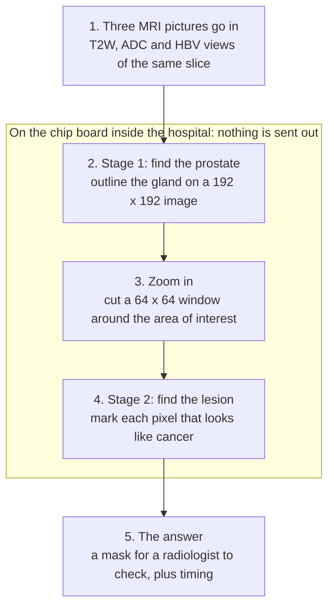

# SegNet-Lite Explained in Plain Language

A walk-through of this project for readers with no AI or hardware background. For the technical summary, see the [README](README.md).

## The short version

SegNet-Lite is a small AI program that looks at prostate MRI scans and colours in the areas that look like cancer. It works in two steps: first it finds the prostate, then it searches only inside that area. It runs on a hand-sized chip board that sits in the hospital, so no scan is sent over the internet. The project reports about 93–95% precision and under 20 milliseconds per scan.

It was built by a team of three ECE students at RSET (Arun K, Omar Sheriff, Adarsh Nair). The problem came from a senior radiologist at Rajagiri Hospital.

## The problem it solves

A cancer spot on a prostate MRI is small, and a radiologist has to find it by eye across three different kinds of image. It is like looking for one slightly darker pebble on a gravel path, in three photos taken with different filters.

AI tools that help with this already exist. They have four common problems:

- **They need big computers.** Most run on racks of expensive graphics servers.
- **They send scans away.** Cloud-based tools move patient images outside the hospital.
- **They raise false alarms.** Tools that scan the whole pelvis flag things that are not in the prostate at all.
- **They are slow.** That makes them hard to use while the patient is still there.

SegNet-Lite answers each one: a small model, kept inside the hospital, that looks only at the prostate and answers in a fraction of a second.

## How it works, step by step

SegNet-Lite uses two small models one after the other, the way you would first find the right page of a map and then look for the street.



The word for step 2 and step 4 is segmentation: the model does not just say "cancer, yes or no", it colours in exactly which pixels. Running two models in a row like this is called a cascade.

## How it was taught

The model learned by example: it was shown scans together with outlines drawn by experts, and it practised until its own outlines matched.

**The practice material.** The public PI-CAI dataset: 1,500 MRI scans from 1,476 patients. Of these, 425 have clinically significant cancer and 220 come with a lesion outline drawn by an expert.

**Three pictures per patient.** Each scan gives three images of the same slice. T2W shows the anatomy, like a normal photo. ADC and HBV show how freely water moves in the tissue. Cancer tissue is tightly packed, so water moves less there and it shows up differently.

**Getting the pictures ready.** Every image is resized to 192 × 192 pixels and its brightness is evened out, so a bright scan and a dull scan look alike to the model. Then a 64 × 64 window is cut around the area of interest.

**The practice loop.** The model sees 8 windows at a time, makes a guess, gets a score, and nudges its internal settings to score better. One pass through all the data is called an epoch. The code runs 70 of them. For every two cancer cases it also sees one healthy case, so it learns what normal looks like.

**The scoring rule.** A lesion covers only a tiny share of the pixels. A lazy model could say "no cancer anywhere" and be right about almost every pixel. Two scoring rules are added together to stop that:

- **Dice** measures how much the model's outline overlaps the expert's. Missing the lesion entirely scores zero, however many healthy pixels were right.
- **Focal loss** gives more weight to the pixels the model finds hard and less to the easy background.

**The shape of the model.** The model is built like an hourglass.

```
picture size at each layer

in   64 px  ################
     32 px      ########
     16 px        ####
      8 px         ##
      4 px         #        smallest view
      8 px         ##
     16 px        ####
     32 px      ########
out  64 px  ################
```

The first half shrinks the picture step by step, which forces the model to keep only what matters. The second half grows it back so the answer is a map the same size as the input.

## Fitting it on a small chip

The trained model is shrunk and moved onto a single chip board, so the hospital needs no server room and no internet link for it.

**The board.** It is a Xilinx ZCU104, built around an FPGA. An FPGA is a chip whose internal wiring can be rearranged for one particular job. A normal processor is a general kitchen; an FPGA is a kitchen rebuilt to cook one dish very fast.

**The AI engine on the chip.** Part of the FPGA is set up as a DPU, a block designed only to run this kind of model. Xilinx's Vitis AI tool converts the trained model into the file the DPU runs.

**Shrinking the numbers.** A trained model is millions of numbers. They start as 32-bit decimals. For the chip they are rounded to 8-bit whole numbers, called INT8 quantisation. It is like rounding every price in a shop to the nearest rupee: the list takes a quarter of the space and adds up faster, and the total barely changes. A quarter of the space is the 75% memory saving.

**Built to suit the chip.** The DPU only supports simple building blocks. The model in `segnet.py` sticks to those on purpose, which the code comments call "DPU safe".

| Benefit | Why |
| --- | --- |
| Privacy | Scans are processed on the board and never leave the hospital |
| Speed | The chip is wired for this one job, so there is no network wait |
| Cost | One board replaces a rack of graphics servers |

## What the numbers mean

| Figure | Value | In plain words |
| --- | --- | --- |
| Lesion precision | about 93–95% | Of every 100 pixels the model marks as cancer, 93 to 95 really are. Few false alarms. |
| Time per scan | under 20 ms | About a fiftieth of a second for the chip to give its answer. |
| Memory saved | 75% | The model takes a quarter of the space after its numbers are rounded to 8 bits. |

Precision answers one question: when the model raises an alarm, how often is it right? It does not say how many real cancers the model misses. That is a separate figure called recall. The code measures recall, but it is not published here yet.

## Honest limits

This repo is a working prototype, not a tested medical tool.

- **The model is graded on scans it studied.** `segnet.py` measures its final scores on the same data it trained on. That is like setting an exam from the practice paper. A fair score needs scans the model has never seen.
- **The two stages are not yet joined.** In both scripts, the zoom window for stage 2 is centred using the expert's lesion outline, not the prostate outline from stage 1. A real patient has no expert outline, so the window would have to come from stage 1.
- **One patient per run.** `pipeline.py` processes a single case and prints its scores and timing.
- **Only half the training is in the repo.** The code trains the lesion model. The prostate model's training script and the converted model files are not here.
- **Most results are not written down.** Dice, IoU, recall and timing are measured by the code but their values are not published. Only the precision figure is stated.
- **No clinical sign-off.** Radiologist validation and regulatory approval are future work.

None of this undoes the engineering: a custom model, trained on a hard problem, quantised and running on an FPGA. It does mean the 93–95% figure is a prototype result.

## Glossary

| Term | Plain meaning |
| --- | --- |
| MRI | A scanner that images the inside of the body with magnets, not X-rays |
| T2W, ADC, HBV | Three kinds of MRI picture of the same slice; each shows tissue differently |
| Lesion | A spot of abnormal tissue; here, suspected cancer |
| csPCa | Clinically significant prostate cancer: cancer serious enough to need treatment |
| Segmentation | Colouring in exactly which pixels belong to something |
| Mask | The coloured-in map that segmentation produces |
| ROI | Region of interest: the part of the image worth looking at |
| Cascade | Two models in a row, the second working on what the first found |
| Encoder–decoder | The hourglass shape: shrink the image, then grow it back |
| Epoch | One full pass through all the training data |
| Loss | The score that tells the model how wrong it was |
| Dice | An overlap score between the model's outline and the expert's; 1 is perfect |
| Focal loss | A scoring rule that pays more attention to hard pixels |
| Precision | Of the alarms raised, the share that were real |
| Recall | Of the real cases, the share that were caught |
| Quantisation (INT8) | Rounding the model's numbers from 32 bits to 8 so it is smaller and faster |
| FPGA | A chip whose wiring can be rearranged for one job |
| DPU | The part of the FPGA set up to run AI models |
| Vitis AI | The Xilinx tool that converts a trained model for the DPU |
| Inference | Using a trained model to get an answer on a new image |
